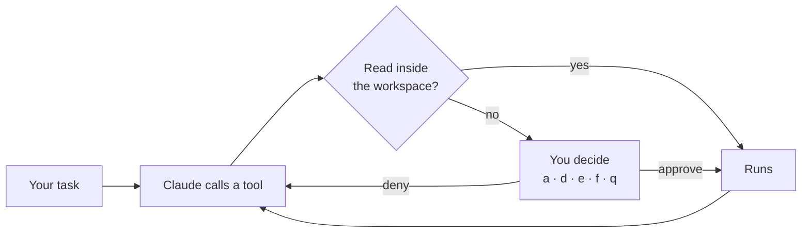

<div align="center">

# Omni

### Your terminal, your friend.

**Intelligence, in your terminal.**

[](https://github.com/parsakalantari85/omni-unity/actions/workflows/ci.yml)
[](https://www.python.org/)
[](https://github.com/anthropics/claude-agent-sdk-python)
[](LICENSE)

[Quick start](#quick-start) · [Features](#features) · [Commands](#commands) · [FAQ](#faq)

<code>pip install -e ./Package_project</code>

<br><br>


</div>

---

Omni runs Claude inside a directory you choose. Describe what you want done, and it plans, reads, edits and runs commands to get there.

Reads inside your workspace happen on their own. Everything else waits for you.

## Quick start

### 1. Install

```bash
git clone https://github.com/parsakalantari85/omni-unity.git
cd omni-unity/Package_project
pip install -e .
```

You need Python 3.10+ and Claude credentials: an `ANTHROPIC_API_KEY`, or an existing Claude Code sign-in.

### 2. Launch

```bash
omni --project ~/dev/my-app
```

### 3. Give it a task

```text
Rename the utils module to helpers and fix every import.
```

## How Omni works

Claude works through the task one tool call at a time, and the approval gate decides which calls need you.



## Features

| Feature | What you get | Try it |
|---|---|---|
| **Approval gate** | Approve, deny with a reason, edit the input, inspect the full payload, or stop the task | Any write or command |
| **Safe reads** | `Read`, `Glob` and `Grep` run without a prompt, but only inside your workspace | Ask a question about the code |
| **Workspaces** | Save a project and its extra directories under a name, then switch in one command | `/workspace save app`, `omni -w app` |
| **Extra directories** | Grant access beyond the working directory | `--add-dir ../shared-lib` |
| **Folder trust** | Asked once per folder, before its settings can start servers or hooks | First launch in a new folder |
| **MCP servers** | Bring your own servers, or reuse the ones already set up for Claude Code | `OMNI_MCP_SERVERS`, `/tools` |
| **Rewind** | Put files back the way they were at your last message | `/rewind` |
| **Model switching** | Change the model without restarting | `/model <name>` |
| **Permission modes** | Plan first, auto-accept edits, and more | `/mode plan` |
| **Interrupt** | Stop a running task immediately | `ctrl-c` |
| **Rich transcript** | Markdown answers, colored diffs, syntax-highlighted previews | Built in |
| **Cost per task** | Turns and cost reported when each task finishes | Built in |

## Commands

| Command | Does |
|---|---|
| `/workspace [open \| save \| remove]` | List, switch, save or forget workspaces |
| `/tools [name]` | List the tools an MCP server exposes |
| `/test` | Check MCP server status |
| `/reconnect [name]` | Reconnect an MCP server (alias: `/restart`) |
| `/model <name>` | Switch the model |
| `/mode <mode>` | Change the permission mode |
| `/rewind` | Restore files to your last message |
| `/clear` | Clear the transcript pane |
| `/exit`, `/quit` | Leave Omni |

Press `?` on an empty prompt to see them all.

## FAQ

<details>
<summary><b>Which model does Omni use?</b></summary>
<br>
The Agent SDK's default, until you pick another with <code>/model &lt;name&gt;</code>.
</details>

<details>
<summary><b>Does my code leave my machine?</b></summary>
<br>
Omni runs locally, but anything Claude reads becomes part of the conversation sent to Anthropic's API, just as it does with Claude Code.
</details>

<details>
<summary><b>Can it run without asking me?</b></summary>
<br>
Yes. <code>/mode acceptEdits</code> auto-accepts file edits, and <code>/mode bypassPermissions</code> or <code>/mode auto</code> turn the gate off once you confirm.
</details>

<details>
<summary><b>Does it use my Claude Code setup?</b></summary>
<br>
Yes, it shares your Claude Code MCP servers and settings files. Set <code>"setting_sources": []</code> in <code>~/.omni/config.json</code> to keep sessions isolated.
</details>

<details>
<summary><b>Where are settings and logs kept?</b></summary>
<br>
Settings are in <code>~/.omni/config.json</code> and the log is at <code>~/.omni/omni.log</code>. Set <code>OMNI_DEBUG=1</code> to see full tracebacks.
</details>

## Contributing

Issues and pull requests are welcome. To run the tests:

```bash
cd Package_project
pip install -e .[dev]
pytest
```

## License

[MIT](LICENSE)
